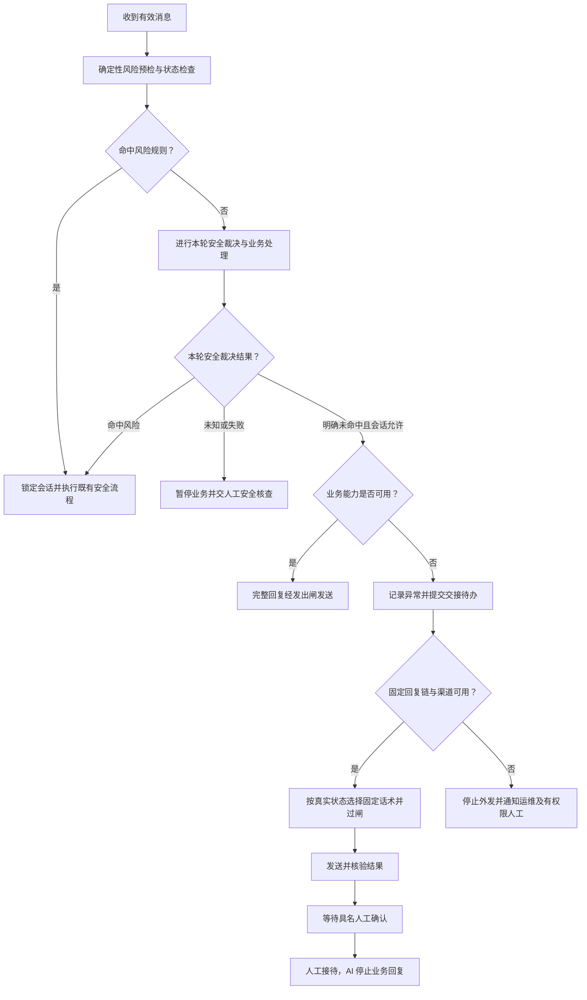

# 微信客服智能体：服务异常兜底对话支持设计方案

版本：V1.0 设计建议稿｜日期：2026-10-23｜适用：知心谷微信客服阶段一、四类角色账号。

本方案补充现有设计中的服务异常闭环，供产品、研发、客服运营及专业负责人评审。当前工程为模拟客服骨架，以下能力与话术不代表已实现或已获上线签发。沿用现有 PRD 的安全、权限和渠道边界；新增时间参数均为建议初值。

## 一、目标与适用边界

异常期间，让用户得到四个明确的信息：当前哪项服务无法完成、自己是否需要做什么、真人处于什么接手状态、此前已确认的信息能否接续。优先保护用户安全，其次保证状态真实，再争取尽快恢复服务。

覆盖模型不可用或超时、知识与排期工具故障、安全判断不可用、输出被拦截、上下文丢失、写入结果未知、微信发送失败、人工无人接手及整套服务不可用。

本方案遵守以下既有边界：

- 只使用已准入的企业微信“微信客服”能力；实际窗口、额度和回执能力逐账号验收，不把设计中的窗口假设当作平台现行规则。
- 阶段一只记录预约意向，最终由真人确认；异常期间不自动成交，不处理支付、退款或订单操作。
- 固定回复、过渡语、安全出口和经系统发送的真人消息均须经过统一发出闸；过闸不可用时停止系统外发。
- 风险锁定不因模型恢复、会话到期、人工待办关闭或用户改问价格而解除。
- 故障不触发服务产品的“二级兜底推介”，不借异常要求加好友、留资或接受营销。

## 二、总体方案：三档服务能力与两条接续路径

| 服务档位 | 进入条件 | 对话能力 | 必须停止的动作 |
| --- | --- | --- | --- |
| 正常接待 | 本轮安全裁决、依赖工具、发出闸及渠道均满足准入 | 按既有首咨及事实问答规则工作 | 未获授权或缺少依据的动作 |
| 受限接待 | 部分业务能力失败，但签发规则、固定话术发出闸、可信会话状态及渠道仍可用 | 说明具体障碍、提供经核实的服务边界、报告真实转接状态；本轮安全裁决明确且条件满足时，可回答未受影响的一般事实 | 受影响的查询、首咨追问、量表、推荐或预约；全部模型不可用时停止生成并强制交人工 |
| 停止自动接待 | 安全或发出闸无法保障、会话身份或状态不可确认、账号权限失效，或核心依赖整体不可用 | 仅在独立且已验收的固定消息链仍满足全部准入时发送服务说明；否则无法自动回复 | 一切未经安全与发送准入的自动消息及业务写入 |

两条接续路径：普通服务异常交客服或个案管理师；安全命中、风险未知或安全能力失效交有权限的安全核查人员。规则明确命中时立即执行危机锁定及告警，不等待普通故障排队。

“停止自动接待”仍须保留内部故障事件、待办及可用的人工工作入口。若入口本身也不可用，进入运维故障流程，不能在记录中虚构人工接续成功。

## 三、异常识别和动作矩阵

| 异常 | 用户侧处理 | 系统侧处理 | 转人工规则 |
| --- | --- | --- | --- |
| 生成缓慢，尚未超时 | 默认不加发“正在输入”或重复等待语；必要时使用一次经签发的过渡语 | 受统一截止时间约束；后续新风险消息可抢占旧任务 | 达截止时间且仍无合格结果，进入故障交接 |
| 主模型超时或报错 | 不让用户自行重问 | 仅允许切换到已验收的备用模型；使用同一上下文、规则和发出闸，总耗时不得因切换重新计时 | 全部模型不可用时固定说明并强制交人工 |
| 知识库、服务目录故障 | 明确“现在无法核实”，不给价格、老师姓名、具体时段 | 记 `timeout/error`，建立故障待办；不得用模型常识或过期缓存补答案 | 同轮发起人工处理，不等第二次故障 |
| 正常检索无答案 | 首次说明边界、可答范围，询问是否需要真人 | 仅 `empty` 进入库外计数，按可核验证据提交计数 | 用户同意即转；累计第二次库外即转 |
| 排期工具失败 | 说明暂时查不到可约时间，具体安排由真人确认 | 保留已合法记录的预约意向；不展示缓存时段、不占位 | 同轮交个案管理师核实 |
| 留资或意向写入超时 | 如实说明尚未确认记录成功，不要求立即重复提交 | 通过原动作标识查询结果；只有确认未完成且允许重试时才重试 | 无法核实则交人工核对，不将未知标成失败或成功 |
| 风险判断超时、规则不可用 | 使用经签发的中性服务中止及交接话术；不把未知描述成危机命中或安全通过 | 标记安全待核查，停止首咨、推荐、量表和预约；已有风险规则命中仍立即锁定 | 立即交有权限的安全核查人员 |
| 输出违规、格式异常 | 不展示违规片段或未经检查的半句话 | 完整消息改写一次复检，再失败则固定兜底复检；固定回复仍失败则停止发送 | 建立人工处理及质量待办 |
| 上下文读取失败、身份绑定不可信 | 说明暂时无法接续此前信息，不复述敏感内容 | 停止业务推进；恢复可信绑定后仅恢复允许的同一会话内容 | 无法可靠恢复则交人工，不让用户重新讲完整经历 |
| 语音转写失败、图片或文件不可解析 | 不声称已读懂；给文字入口，并允许用户不再重述 | 标记内容未判定并建人工核看待办，不记为风险阴性 | 交人工核看；若同时命中风险规则则优先安全流程 |
| 发送被拒、额度或窗口耗尽 | 同一失效渠道可能无法提示，不能以“已回复”结案 | 查原请求结果及账号能力；只走已验证、获授权的替代路径 | 待人工核查；替代路径也必须遵守各自权限 |
| 发送结果未知 | 不立刻再发一条兜底，避免用户收到重复或矛盾回复 | 保留原请求号和幂等键；阻塞该会话后续普通发送，核实原结果 | 无法核实则交人工处理未知状态 |
| 真人迟迟未接 | 初次过渡如实说明等待；后续不因用户追问而追加 AI 回复 | 按实际排班升级；新消息进入同一交接任务；全链无人接手或超时回退的告知仅按 PRD 特定状态事件执行 | 用户明确要求人工时保持人工等待，不擅自恢复业务问答 |
| 用户要求停止回复 | 执行既有停止策略，不再发送普通故障安抚和恢复通知 | 停止待发普通消息，保留必要内部记录；与风险并发时按已签安全规则处理 | 内部风险动作不借此重新打开普通 AI 会话 |

同一意图澄清最多两次；连续两轮未解决即转人工，先达到哪条转人条件就执行哪条。技术故障和正常库外分别计数，不能让用户等两次故障才得到人工处理。

## 四、对话状态与发送状态分开维护

不要用“转人工”一个布尔值承载全部过程。沿用现有会话、安全和出站状态，增加可查询的故障上下文，至少区分以下维度：

| 维度 | 建议状态 | 状态变化依据 |
| --- | --- | --- |
| 会话控制权 | AI 接待、等待人工、人工接待、已停止 | 有权限的状态事件；真人确认后才能写“人工接待” |
| 安全状态 | 本轮裁决明确、安全待核查、风险锁定 | 已签规则和合法核查结果，独立于服务健康 |
| 服务能力 | 正常、受限、停止自动接待 | 受影响组件与必需准入能力的实际健康情况 |
| 交接状态 | 未发起、已提交、等待确认、真人已确认、失败待接续 | 待办持久化、实际通知证据、具名人工确认分别记录 |
| 出站状态 | 待审核、待发送、发送中、平台受理、已核验发出、已核验送达、失败、未知、已取消 | 渠道实际证据；平台受理不能推导送达 |

普通异常主流程：

每条新消息都可触发安全抢占。进入“等待真人接手”后，沿用 PRD §8.1：只允许一次已签过闸的过渡提示，AI 随后静默；用户追问进度或资料状态也不能触发额外自动回复，新消息进入同一交接任务。全链无人接手、超时回退等已有明确规定的告知，须由对应状态事件及签发权限触发，不能泛化为任意等待态应答。危机锁定态依现有安全规则处理后续消息，不套用普通排队应答。

## 五、可配置的超时、重试与消息预算

以下为建议初值，需结合真实账号、发出闸耗时和峰值压测调整，不作为对用户的时限承诺。

| 参数 | 建议值或规则 | 说明 |
| --- | --- | --- |
| 常规处理截止点 | 入站后 5 秒仍未取得可用业务结果，取消未完成的普通处理并切入兜底 | 给组装、过闸和实际发送预留时间；继承原设计首响中位数 ≤3 秒、P90 ≤8 秒的目标 |
| 首次服务说明 | 依赖允许时，目标入站后 8 秒内实际发出完整正常回复或兜底 | 无发送证据记失败或未知，不能凭请求发出认定达标 |
| 备用模型 | 单轮至多一次，且必须位于剩余处理预算内 | 安全规则与发出闸故障不能靠换生成模型规避 |
| 只读工具重试 | 单轮至多一次，仅对已识别的暂时性错误且预算足够时执行 | 权限失效、参数错误和确定性拒绝不盲重试；失败后按工具类型降级 |
| 写入和消息发送重试 | 先核实原结果，确认允许后使用原幂等标识有限重试，首版建议至多一次 | 不支持查询或无法判定时交人工；内部幂等键不能假定微信平台支持幂等 |
| 普通交接内部目标 | 工作时段 2 分钟未确认提醒，5 分钟未确认升级 | 新增建议，须运营结合实际排班核定；不自动向用户承诺“5 分钟回复” |
| 危机交接 | 沿用工作时段 1 分钟未确认升级，≤5 分钟确认的现有目标 | 非工作时段记录次日接续，不虚构值班电话升级 |
| 故障提示频率 | 同一入站最多一条主动故障说明；等待真人态只允许一次过渡提示，不逐条入站重新计数 | 后续追问由真人接续；仅已获准的特定状态事件及安全规则可触发相应通知，仍服从平台限制 |

默认将“说明障碍＋真实交接状态＋下一步”合成一条消息，减少额度消耗。若此前已经发送过渡语，最终兜底只补必要的新状态，不再重复开头。普通模板不重复使用同一句；危机固定话术按四角色逐字一致的既有规则执行，角色不得自行改写。

## 六、固定话术与使用前提

所有话术均为待签发草案。系统通过有限状态与受控字段选择模板，不让故障模型自由补充。首条用户可见回复仍须满足既有 AI 身份告知规则；例如在故障说明前加入“我是知心谷的 AI 客服”。

| 编号及场景 | 建议话术 | 发送前必须确认 |
| --- | --- | --- |
| F01：普通故障，交接已提交 | “抱歉，现在暂时无法继续处理这个问题。转人工请求已提交，目前还在等待真人客服接入。” | 交接请求已持久化成功；未把提交写成接手 |
| F02：价格或服务事实核验失败 | “现在暂时无法核实这项服务信息，具体内容需要由真人客服确认。转接请求已提交，目前还在等待接入。” | 交接提交成功；不给具体价格、老师姓名或时段 |
| F03：排期查询失败 | “现在暂时查不到可约时间，具体安排需要由真人老师确认。我已提交人工核实请求，目前还未确认接手。” | 核实任务已提交；不得把预约意向描述为预约成功 |
| F04：写入结果未知 | “刚才的信息是否记录成功，目前还无法确认。请先不要重复提交，后续需要由真人客服核实。” | 原动作确为未知；不能声称已保存资料或已通知成功 |
| F05：人工服务台人工回复进度 | “目前还在等待接待人员确认，暂时无法给出准确的等待时间。” | 仅供实际在岗人员人工回复；不能作为等待态 AI 自动回复；若发出人即接待人员，应先确认接手再用 F06 |
| F06：人工确认接手 | “您好，我是本次接待的真人客服，将由我接着处理。” | 具名真人已确认，并由真人发送；AI 不冒充真人 |
| F07：当前无人可接 | “现在暂时无法接入真人客服。如需继续，可在公示的人工服务时段回到本会话留言。” | 当前确无可接人员；公示时段真实有效，不保证届时立即有人 |
| F08：非工作时段，待办已记录 | “目前不在人工服务时段，暂时无法接入真人客服。您的问题已列入下一工作时段的接续名单。” | 次日接续待办确已落库且有责任岗位；不是实时接手 |
| F09：交接系统也故障 | “现在暂时无法继续处理，也无法确认转接是否成功。如需继续，可在公示的人工服务时段回到本会话留言。” | 固定回复链可用；不得声称请求已提交或信息已保存 |
| F10：上下文无法恢复 | “现在暂时无法接续此前的对话，我先暂停后续提问，避免重复询问。接下来需要由真人客服协助核实。” | 不引用无法验证的历史内容，不承诺真人已读过记录 |
| F11：语音内容未判定 | “这段语音暂时无法可靠识别。您愿意的话，可以改发文字；不方便重述也可以，内容需要由真人核看。” | 语音合法取得但转写失败；人工核看任务已建立 |
| F12：安全判断不可用 | “现在暂时无法继续这一步，我先暂停后续提问，交由有权限的真人工作人员核实。” | 人工核查任务已持久化；不把判断服务异常说成用户有风险 |
| F13：恢复后的用户主动接续 | “我是知心谷的 AI 客服，现在已恢复。您想继续刚才的问题吗？” | 用户重新发言；非人工接待、非停止、非风险锁定；必要准入已恢复 |

补充使用规则：

- F01/F02/F03 中“已提交”只能由交接成功事件触发；失败使用 F09，结果未知则明确尚未确认。
- 仅在可信同一会话摘要可读取时，才可补充“已确认的信息会随本次交接提供，您不必从头再说”；不能保证完整记录可用时不作此承诺。
- 用户明确要求人工时直接发起交接，不再询问“确定要转吗”，不以继续 AI 接待为默认选项。
- F01/F02/F03/F08 等转接说明按实际状态择一，组成等待态唯一过渡提示，不串联发送。F07 作为初次说明，或仅在 PRD 已允许的“全链无人接手”状态事件下发送；普通进度追问不能触发它。
- 已接手真人可按权限读取现有记录；不因模型故障要求用户重新提供手机号、称呼或完整经历。
- 普通服务故障不自动附上心理热线。危机命中时使用独立、经持证人员签发的安全话术和资源映射，必须包含适用的求助出口及即时动作，并按既有意愿分支执行。
- 12356 等拟用资源须完成地区、时段及可用性核验后才能装载；不在通用故障模板中硬编码为随时可用。
- 未成年保护、第三人披露和危机沉默等分支，完全沿用既有签发流程，不另建未经审核的安抚或紧急联系人话术。

普通对话示例：

> 用户：明天下午可以约吗？  
> 系统：现在暂时查不到可约时间，具体安排需要由真人老师确认。我已提交人工核实请求，目前还未确认接手。  
> 用户：那我刚才填的信息还要再发吗？  
> 系统动作：将新消息加入原交接任务，AI 保持静默。  
> 真人确认后：您好，我是本次接待的真人客服，将由我接着处理。刚才已确认的信息可以接续，您不必重新发送。

“系统动作”为内部处理说明，不发给用户。真人回复中关于记录可接续的表述，以可信记录确实可用为前提；记录未知时如实说明待核实，不要求立即重复提交。

## 七、人工接管与交接内容

普通异常交接包由程序字段优先组装；模型不可用时直接使用结构化信息及最小原话片段，不依赖模型总结。内容包括：

1. 渠道、账号、可信用户与会话标识，以及已存在的风险或停止状态。
2. 用户当前待解决的问题和原话依据；不新增临床判断。
3. 故障类型、发生时间、失败环节、已重试次数及原动作标识。
4. 已确认的信息、未知项及拒绝项；沿用“用户不愿说／未展开”的区分。
5. 相关出站内容、实际发送与可见证据、失败或未知原因。
6. 已执行的业务动作和结果，尤其是写入未知、预约意向与预约确认的区别。
7. 分配岗位、通知证据、人工确认及超时升级记录。

手机号等只存既有授权字段，交接包使用权限受控的引用，不复制到通用日志或普通摘要。危机交接继续使用 PRD FR-12 的六项信息卡，不能用普通故障交接包替代。

真人确认接手后，原子更新会话控制权及版本，取消未发送的普通 AI 回复；正在发送的请求继续核验原结果，不能当作已撤回。用户新消息归入同一人工任务，避免每条消息都生成一个工单。

非工作时段与无人接手分开处理：前者按真实排班建立下一工作时段待办；后者表示排班内承接失败，必须告警和升级。两者都不能通过把会话改为“人工”伪造接手。

## 八、故障期间的最小技术支持

建议在统筹者之外设置独立的异常控制模块，读取持久化状态并选择已签发模板。其运行不依赖生成模型；固定回复仍调用同一发出闸，不设绕行通道。

最小依赖包括：可信入站与去重、会话状态及版本、签发规则和模板、固定回复的发出闸、实际发送适配器、持久化异常/交接待办、可验证的通知渠道。任一必要依赖失效时，收缩相应能力；数据库不可用或无法可靠留痕时，不声称“已记录”，也不在用户数据状态未知时推进业务。

建议故障上下文记录 `incident_id`、`trace_id`、`inbound_id`、`failure_type`、`affected_component`、`service_mode`、`template_version`、`handoff_id`、`retry_count` 和服务端时间。它们是待落地的数据建议，沿用现有隔离域与审计契约，不替代现有模型。

故障、待办和待发送消息尽量在同一事务内落库，由后台投递；工作器重启后按原标识恢复。数据库整体失效时依赖独立健康告警和运维流程，不能宣称事务消息仍能正常运作。

微信通道故障时，同一通道通常无法再发故障说明。可使用的降级出口仅限事先验收且获得授权的原生人工入口、人工操作台或机构控制的入口页提示；需要时暂停可控入口的新增导流。不得假定能修改所有微信入口，不凭历史手机号跨渠道联系，也不将机构应用告警当作对客送达。

## 九、恢复与防止重复对话

恢复按组件和账号执行，先探测、后小范围验证、再恢复自动能力。建议初值为连续 3 次探测成功、至少观察 60 秒，并验证安全判断、发出闸、知识有效性、发送能力和待办积压；涉及安全与权限的故障须由对应负责人确认后开放。

恢复只改变服务能力，不自动夺回正在等待或已由真人接待的会话。用户明确要求人工的请求继续保留。仅普通非危机、准入完整且原路由允许的场景，可在如实告知并经用户选择后恢复受限 AI；风险锁定和未成年人风险态不得走此路径。

旧任务不得批量重放：取消的回复不补发，迟到结果只更新原请求，写入未知先核实，已被真人解决的问题不再由 AI 回答。停止状态下不发送恢复通知；普通会话也默认等待用户主动回来，避免主动通知消耗窗口和造成打扰。

具体内容仅可在同一合法有效会话、现有不超过 48 小时的恢复上限及更短的平台限制内恢复；超过边界或绑定不可信时，不通过其他账号、渠道或长期记忆拼出主诉。

## 十、验收与度量

| 验收场景 | 必须达到的结果 |
| --- | --- |
| 全部模型不可用 | 固定链可用时能正确说明并交接；固定链不可用时不绕闸发送 |
| 安全裁决超时与知识工具同时失败 | 不生成“安全通过”，不继续首咨、量表、推荐或预约 |
| 确定性规则未命中，语义判断命中风险 | 立即进入安全流程，不产生常规回复或普通故障交接话术 |
| 两次正常库外与两次技术错误 | 前者按库外两段式；后者首次即故障交接，计数互不污染 |
| 交接创建成功但通知失败 | 只显示已提交或待接续，不显示已接手 |
| 值班人未确认、非工作时段 | 分别走排班内升级、下一工作时段接续；无虚构时限及接手 |
| 已发送一次转接过渡提示，用户继续问进度或资料状态 | AI 不追加回复，新消息入原任务；仅真人或 PRD 特许的状态通知可响应 |
| 发出闸拒绝或不可用 | 不外发未审回复；固定兜底也必须复检 |
| 平台受理后回执丢失 | 不记送达，不盲重发；按原请求核实并保留未知待办 |
| 平台窗口或额度耗尽 | 不突破限制；失败不能通过改用另一模板伪装为成功 |
| 同一入站重复三次 | 同一业务动作、交接任务和对客故障说明最多各一次 |
| 预约意向写入未知 | 不重复创建，不输出预约成功，不再次索要相同资料 |
| 人工接手与旧 AI 任务完成同时发生 | 未发旧回复被取消；在途结果被核验，人工控制权不被覆盖 |
| 等待故障回复时出现风险消息 | 立即按规则锁定，取消未发普通回复并启动安全链 |
| 故障恢复、用户 STOP、超恢复窗口 | 分别验证无旧消息重放、无普通恢复通知、无敏感历史复述 |
| 上下文丢失或跨账号进入 | 不串会话、不猜身份、不自动关联敏感内容 |

度量口径：

- 继承完整回复实际发出的首响目标：中位数 ≤3 秒、P90 ≤8 秒。兜底与正常回复分别统计，避免用快速故障提示掩盖业务不可用。
- 同时统计异常消息中“有实际发出证据的说明比例”“用户侧可核验触达比例”“失败与未知比例”。未知样本不能从可靠性分母中删除；无实际发出时间的样本不进入时延成功分布。
- 转接分别统计提交成功、通知成功、具名人工确认及超时存量；普通服务与危机分开统计，非工作时段另算次日接续。
- 将错误宣称真人接手、错误宣称送达、故障期编造业务事实、重复写入、风险锁定被恢复覆盖及越闸发送列为零容忍验收项。
- 危机仍只核对机构侧已执行动作，不记录用户是否拨通、承接方是否受理，不为确认结果再次联系用户。

实施顺序建议：先完成固定话术链、真实出站状态、幂等与具名人工交接；再补工具分类降级、服务健康控制、未知结果核实及恢复；最后用各真实账号做故障注入和非工作时段演练。专业话术、值班排班、渠道证据及固定闸验收未齐备的能力保持关闭。

## 十一、依据与待落地事项

- [微信客服智能体PRD](./微信客服智能体PRD.html)：FR-08 库外两段式，FR-10 发出复核，FR-11～13 安全闭环，FR-16～17 换人与真人接手，FR-20 接管开关，FR-29 值班，FR-35 预约，FR-36～39 渠道准入。
- [智能体设计方案](./微信客服智能体-智能体设计方案.html)：消息契约、检索五态、消息抢占、出站证据、首响口径及失败关闭。
- [智能体设计框架](./微信客服智能体-智能体设计框架.html)：第七章三条异常闭环及全部模型不可用规则。
- [新建首轮研发台账](./新建首轮研发台账.md)：当前模拟实现边界、完整业务与真实渠道的待实施及待验事项。

新增待落地项：本方案各类模板签发与版本管理、普通交接时限核定、逐账号故障出口验收、固定链独立运行验证、发送和写入未知结果核实操作、服务恢复负责人及演练记录。
